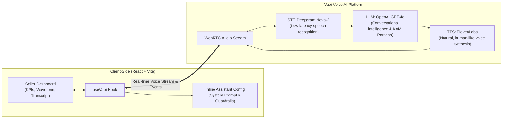

# Snapdeal AI Voice KAM (Key Account Manager)

An intelligent, browser-based, two-way conversational voice assistant built for Snapdeal sellers. The AI KAM diagnoses sales performance issues, investigates root causes through targeted questioning, and recommends practical, high-impact business actions.

---

## 1. Business Scenario & Mock Data

A Snapdeal seller contacts their Virtual Key Account Manager:
> *"My sales have dropped significantly this month. I don’t understand why. Can you help me?"*

### Performance Metrics Comparison

| Metric | Last Month | This Month | Change (%) | Key Diagnostic Insight |
| :--- | :---: | :---: | :---: | :--- |
| **Sales** | ₹2,00,000 | ₹1,35,000 | **-32.5%** | Revenue contracted by ₹65,000. |
| **Orders** | 400 | 270 | **-32.5%** | Order decline directly mirrors sales drop (volume-driven). |
| **Average Selling Price (ASP)** | ₹500 | ₹500 | **0.0%** | ASP is completely flat — pricing is **not** the cause. |
| **Out-of-Stock Products** | 5 | 18 | **+260%** | **Primary Issue 1:** 13 key products ran out of stock, killing conversion and search visibility. |
| **Cancellation Rate** | 8% | 14% | **+75%** | **Primary Issue 2:** Surge in cancellations (+6pp) hurts net realized revenue and platform seller tier. |

---

## 2. System Architecture & Tech Stack



- **Frontend Framework:** React 18, TypeScript, Vite
- **Styling:** Tailwind CSS v4 with custom Snapdeal design tokens (`#E40046`)
- **Voice Platform:** Vapi Web SDK (`@vapi-ai/web`)
- **Speech-to-Text (STT):** Deepgram Nova-2 (ultra-low latency transcription)
- **Language Model (LLM):** OpenAI GPT-4o (structured conversational system prompt)
- **Text-to-Speech (TTS):** ElevenLabs (natural conversational voice with low latency)
- **Audio Visualizer:** Dynamic multi-bar audio waveform driven by live microphone volume levels

---

## 3. Conversational Workflow & Prompt Engineering

The system prompt in [`src/services/vapiConfig.ts`](file:///Users/ratnesh/Documents/Projects/vapi-snapdeal-assessment/src/services/vapiConfig.ts) enforces a strict 5-stage conversational lifecycle:

1. **Warm Greeting & Intake:** Introduce as Snapdeal KAM and listen attentively without immediately dumping metrics.
2. **Contextual Investigation:** Ask **one question at a time** exploring supply chain, fulfillment SLAs, cancellations, or inventory bottlenecks.
3. **Data-Grounded Diagnostics:** Connect the seller's answers to the metrics:
   - Clarify that pricing is steady (₹500 ASP).
   - Unpack the 260% spike in Out-of-Stock SKUs.
   - Highlight the 14% cancellation rate escalation.
4. **Actionable Recommendations:**
   - **Restock high-demand inventory:** Establish safety stock buffers and automated replenishment alerts.
   - **Audit fulfillment & dispatch SLAs:** Bring cancellation rates down below 5–8%.
   - **Regain organic visibility:** Run targeted promotions / sponsored ads once catalog stock is back online.
5. **Call Summary & Wrap-up:** Crisp recap of confirmed issues, agreed next steps, and follow-up timeline.

---

## 4. Getting Started

### Prerequisites
- Node.js (v18+)
- A Vapi account with a **Public Key** ([dashboard.vapi.ai](https://dashboard.vapi.ai))

### Setup & Run
1. Clone the repository and install dependencies:
   ```bash
   npm install
   ```

2. Configure environment variables in `.env`:
   ```bash
   VITE_VAPI_PUBLIC_KEY=your_vapi_public_key_here
   ```

3. Start the development server:
   ```bash
   npm run dev
   ```

4. Open [http://localhost:5173/](http://localhost:5173/) in Google Chrome.

---

## 5. Project Structure

```
vapi-snapdeal-assessment/
├── src/
│   ├── components/
│   │   ├── conversation/
│   │   │   └── TranscriptPanel.tsx  # Live conversation transcript
│   │   ├── dashboard/
│   │   │   └── Dashboard.tsx        # Responsive 3-column layout
│   │   ├── insights/
│   │   │   └── InsightsPanel.tsx    # Diagnostic findings & recommendations
│   │   ├── metrics/
│   │   │   └── MetricsPanel.tsx     # 5 core seller KPI cards
│   │   ├── voice/
│   │   │   └── VoicePanel.tsx       # Mic button, audio visualizer, call timer
│   │   └── Header.tsx               # Snapdeal branding & connection badge
│   ├── data/
│   │   └── sellerData.ts            # Typed seller metrics & formatters
│   ├── hooks/
│   │   └── useVapi.ts               # Vapi SDK lifecycle & WebRTC state management
│   ├── services/
│   │   └── vapiConfig.ts            # System prompt & inline assistant configuration
│   ├── types/
│   │   └── index.ts                 # TypeScript types & interfaces
│   ├── App.tsx                      # App root & config boundary
│   ├── main.tsx                     # React DOM entry
│   └── index.css                    # Tailwind v4 styles & keyframe animations
├── package.json
├── vite.config.ts
└── README.md
```
