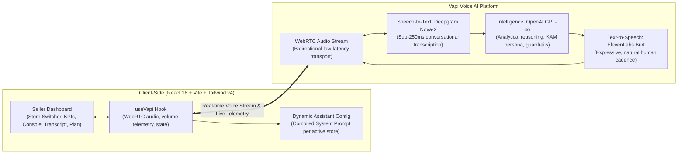
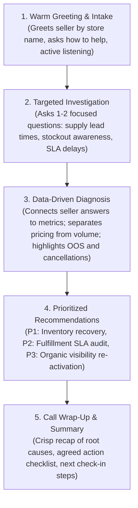

# Snapdeal AI Voice KAM (Key Account Manager)

An intelligent, browser-based, two-way conversational voice assistant built for Snapdeal sellers. The AI Key Account Manager (KAM) diagnoses sales performance issues, investigates root causes through targeted questioning, and recommends practical, high-impact business actions across multiple seller stores.

---

## 1. Multi-Business Performance Scenarios

The platform includes an extensible, typed business configuration layer (`src/data/sellerData.ts`). You can switch between different seller accounts in real time using the **Store Switcher** in the header.

### Pre-Configured Seller Stores

#### 1. Rajesh Electronics (`SNP-2024-1847`) — *Core Assessment Scenario*
- **Category:** Electronics & Mobile Accessories | **Tier:** Gold Partner (4.3 ⭐)
- **Problem Statement:** *"My sales have dropped significantly this month. I don’t understand why. Can you help me?"*

| Metric | Last Month | This Month | Change (%) | Diagnostic Finding |
| :--- | :---: | :---: | :---: | :--- |
| **Sales** | ₹2,00,000 | ₹1,35,000 | **-32.5%** | Revenue contracted by ₹65,000. |
| **Orders** | 400 | 270 | **-32.5%** | Volume decline perfectly mirrors revenue drop. |
| **Average Selling Price (ASP)** | ₹500 | ₹500 | **0.0%** | ASP is flat — pricing is **not** the cause of decline. |
| **Out-of-Stock (OOS) SKUs** | 5 | 18 | **+260%** | **Root Cause 1:** 13 hero SKUs ran out of stock, suppressing organic visibility. |
| **Cancellation Rate** | 8% | 14% | **+75%** | **Root Cause 2:** Escalated cancellations (+6pp) lead to penalty fees and suppressed buy-box. |

---

#### 2. Aarav Footwear & Apparel (`SNP-2024-3912`) — *Fashion & Logistics Scenario*
- **Category:** Footwear & Lifestyle | **Tier:** Platinum Merchant (4.6 ⭐)
- **Problem Statement:** *"Revenue dropped by 30% even though I ran heavy discounts. What is happening?"*
- **Key Metrics:** Sales down from ₹4.50L to ₹3.15L (-30%), ASP down from ₹750 to ₹600 (-20%), Cancellations surged to **19%** (+216%).
- **Diagnostic Finding:** Uncoordinated blanket discounting eroded margins without lifting order volume, while regional third-party courier pickup failures caused an alarming 19% order cancellation rate.

---

#### 3. Kavita Home Essentials (`SNP-2024-5108`) — *High Growth & Stockout Scenario*
- **Category:** Home & Kitchen Appliances | **Tier:** Silver Seller (4.1 ⭐)
- **Problem Statement:** *"Sales grew +33%, but I'm worried we are running out of products and getting delayed."*
- **Key Metrics:** Sales grew from ₹1.80L to ₹2.40L (+33.3%), Orders surged from 300 to 480 (+60%), Out-of-Stock jumped from 12 to **25 items** (+108%), Cancellations rose from 5% to 9%.
- **Diagnostic Finding:** High consumer demand is hitting a severe inventory wall. Warehouse packaging delays are creating an operational backlog that threatens store momentum.

---

### How to Add More Businesses

Adding a new business requires zero UI changes. Simply append a new profile to `businesses` in [`src/data/sellerData.ts`](file:///Users/ratnesh/Documents/Projects/vapi-snapdeal-assessment/src/data/sellerData.ts):

```typescript
{
  id: "my-seller-store",
  name: "My Seller Store",
  sellerId: "SNP-2024-9999",
  category: "Beauty & Personal Care",
  tier: "Gold Partner",
  rating: 4.5,
  avatarColor: "bg-purple-600",
  tagline: "Organic skincare & herbal essentials",
  scenarioDescription: "Brief description of the seller scenario...",
  metrics: [ /* 5 SellerMetric objects */ ],
  insights: [ /* Diagnosed root causes */ ],
  actions: [ /* Prioritized recommendations */ ],
  suggestedPrompts: [ /* Quick speaking ideas */ ],
  diagnosisFramework: { /* Diagnostic logic */ }
}
```

The Store Switcher, KPI cards, interactive action plan, and the AI Voice KAM prompt will automatically adapt to the new store!

---

## 2. System Architecture & Tech Stack



- **Frontend Framework:** React 18, TypeScript, Vite
- **Styling:** Tailwind CSS v4 with custom Snapdeal brand tokens (`#E40046`)
- **Voice Infrastructure:** Vapi Web SDK (`@vapi-ai/web`)
- **Speech-to-Text (STT):** Deepgram Nova-2 (`en`)
- **Language Model (LLM):** OpenAI GPT-4o (`temperature: 0.7`)
- **Text-to-Speech (TTS):** ElevenLabs (`voice: Burt`)

---

## 3. Conversational Lifecycle & Dynamic Prompting

The assistant configuration ([`src/services/vapiConfig.ts`](file:///Users/ratnesh/Documents/Projects/vapi-snapdeal-assessment/src/services/vapiConfig.ts)) dynamically compiles system prompts per active store. It enforces a 5-step conversational flow:



### Conversational Voice Guardrails
- **Brevity:** Spoken responses stay under 2–3 sentences.
- **One Question at a Time:** Never bombards the seller with multiple questions.
- **Natural Number Pronunciation:** Spoken as *"one lakh thirty-five thousand"* or *"thirty-two percent"*, not raw code symbols.
- **No Data Dumping:** Metrics are introduced conversationally when relevant.
- **Barge-In / Interruption Support:** The seller can interrupt the assistant at any time to redirect the conversation.

---

## 4. UI/UX Features & Enterprise Dashboard

- **Store Switcher Dropdown:** Fast switching across configured stores with monthly GMV badges and active-call safety lock.
- **Visual Metric KPI Cards:** Formatted currency, comparative relative progress bars (this month vs peak), and colored trend badges.
- **Live Voice Interaction Hub:**
  - High-visibility pulsating microphone button with live WebRTC connection indicators.
  - 7-bar dynamic audio waveform responding to volume telemetry.
  - Live duration timer (`mm:ss`).
  - **Clickable Prompt Chips:** Suggested questions tailored to the active store (e.g., *"Why did my sales drop 32%?"*). Clicking copies the prompt to the clipboard.
- **Live Transcript Panel:** Distinct avatars for the Snapdeal KAM bot and the active seller, with a **"Copy Notes"** button to export the conversation.
- **Interactive Action Plan Checklist:** Color-coded diagnostic root causes and actionable recommendations with interactive checkboxes for marking items as "Agreed" during the call.

---

## 5. Getting Started

### Prerequisites
- Node.js (v18+)
- A Vapi account with a **Public Key** ([dashboard.vapi.ai](https://dashboard.vapi.ai))

### Setup & Run
1. Clone the repository and install dependencies:
   ```bash
   npm install
   ```

2. Configure environment variables in `.env`:
   ```bash
   VITE_VAPI_PUBLIC_KEY=your_vapi_public_key_here
   ```

3. Start the development server:
   ```bash
   npm run dev
   ```

4. Open [http://localhost:5173/](http://localhost:5173/) in Google Chrome.

---

## 6. Recommended 1–2 Minute Demo Video Script

For your assessment recording submission, follow this natural conversation flow:

1. **Select Store:** Choose **Rajesh Electronics** in the top store switcher.
2. **Start Call:** Click the red microphone button and allow microphone access.
3. **Greeting:** Listen to the KAM's opening greeting:
   > *"Hello! I'm your Snapdeal Key Account Manager. I've pulled up the monthly business analytics for Rajesh Electronics. How can I assist you with your store today?"*
4. **Seller Query:** Say:
   > *"Hi, my sales have dropped significantly this month and I don't understand why. Can you help me?"*
5. **Investigation:** When the KAM asks about your inventory or stockouts, say:
   > *"Actually yes, I had supply issues and didn't realize so many items went out of stock."*
6. **Diagnosis:** Listen to the KAM explain that pricing is stable (ASP flat at ₹500), but 18 items are OOS (+260%) and cancellations spiked to 14%.
7. **Action Items:** Ask:
   > *"What practical steps should I take to fix this?"*
8. **Summary:** Ask:
   > *"Can you give me a quick summary of our action plan?"*
9. **Checklist:** Check off the action items in the right-hand panel as you agree to them!
10. **End Call:** Click **End Call** to wrap up the session.

---

## 7. Project Structure

```
vapi-snapdeal-assessment/
├── src/
│   ├── components/
│   │   ├── conversation/
│   │   │   └── TranscriptPanel.tsx     # Real-time transcript with avatar bubbles & copy notes
│   │   ├── dashboard/
│   │   │   └── Dashboard.tsx           # 3-column responsive layout
│   │   ├── header/
│   │   │   └── BusinessSwitcher.tsx    # Multi-business store selector dropdown
│   │   ├── insights/
│   │   │   └── InsightsPanel.tsx       # Root causes & interactive action checklist
│   │   ├── metrics/
│   │   │   └── MetricsPanel.tsx        # 5 KPI cards with relative comparison bars
│   │   ├── voice/
│   │   │   └── VoicePanel.tsx          # Mic button, 7-bar audio waveform, suggested chips
│   │   └── Header.tsx                  # Snapdeal branding & connection badge
│   ├── data/
│   │   └── sellerData.ts               # Multi-business configuration & formatting utilities
│   ├── hooks/
│   │   └── useVapi.ts                  # Vapi SDK lifecycle, WebRTC events & state
│   ├── services/
│   │   └── vapiConfig.ts               # Dynamic system prompt & inline assistant configuration
│   ├── types/
│   │   └── index.ts                    # TypeScript types & interfaces
│   ├── App.tsx                         # Root app & config boundary
│   ├── main.tsx                        # React DOM entry
│   └── index.css                       # Tailwind v4 styles & custom keyframe animations
├── package.json
├── vite.config.ts
├── SUBMISSION_NOTE.md                  # 1-Page technical write-up for assignment submission
└── README.md                           # Documentation & user guide
```

---

## 8. Evaluation Rubric Alignment

| Rubric Parameter | Weight | Implementation Details |
| :--- | :---: | :--- |
| **Voice interaction and natural conversation** | **30%** | WebRTC two-way voice with Vapi SDK, sub-second latency, speech barge-in/interruption support, and volume waveform telemetry. |
| **Understanding seller queries** | **20%** | Active listening, 1-question-at-a-time investigation, contextual memory, and spoken prompt suggestions. |
| **Quality of business recommendations** | **20%** | Grounded in mock numbers: inventory replenishment, SLA audit for cancellations, and sponsored ad re-activation. |
| **AI implementation and workflow** | **20%** | Clean transient inline assistant config (no remote dashboard lock-in), dynamic prompt generator per seller, typed data layer. |
| **Creativity and execution** | **10%** | Multi-business store switcher, interactive action item checklist, relative comparison bars, and "Copy Notes" functionality. |
